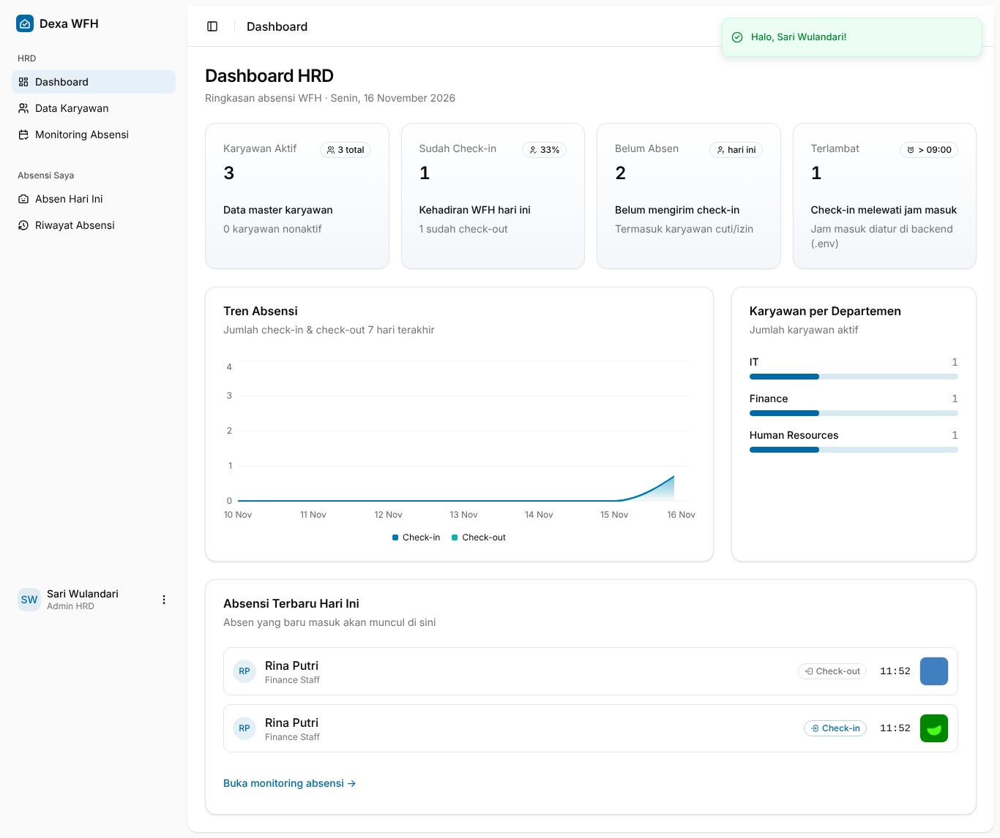
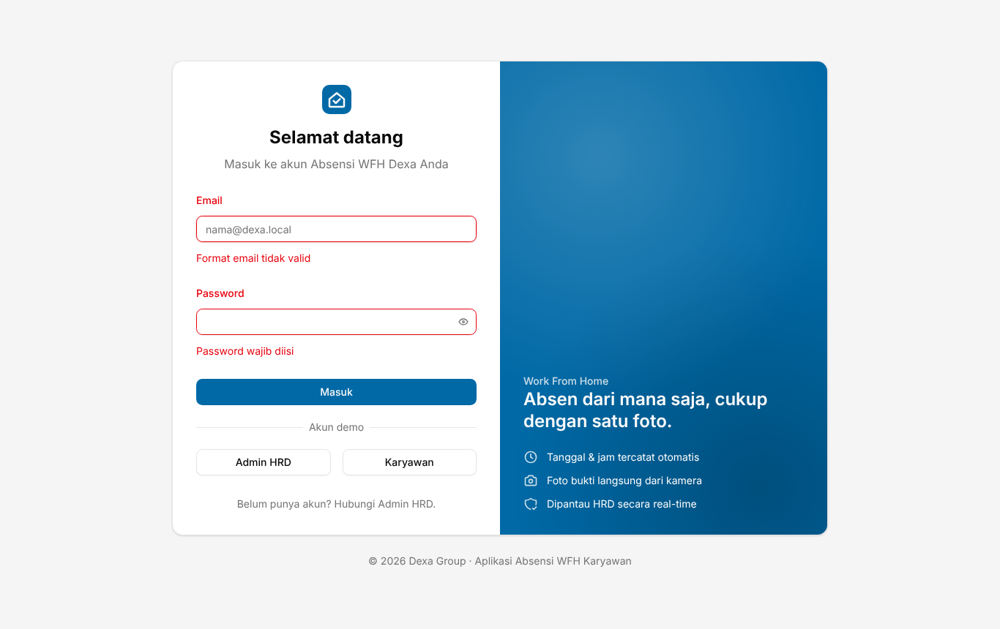
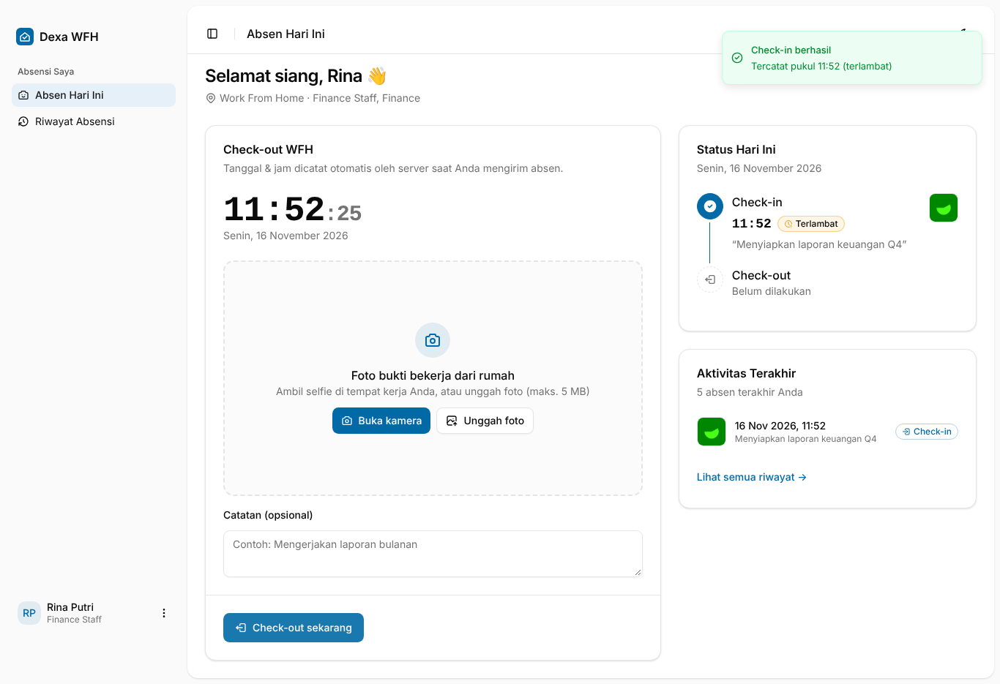
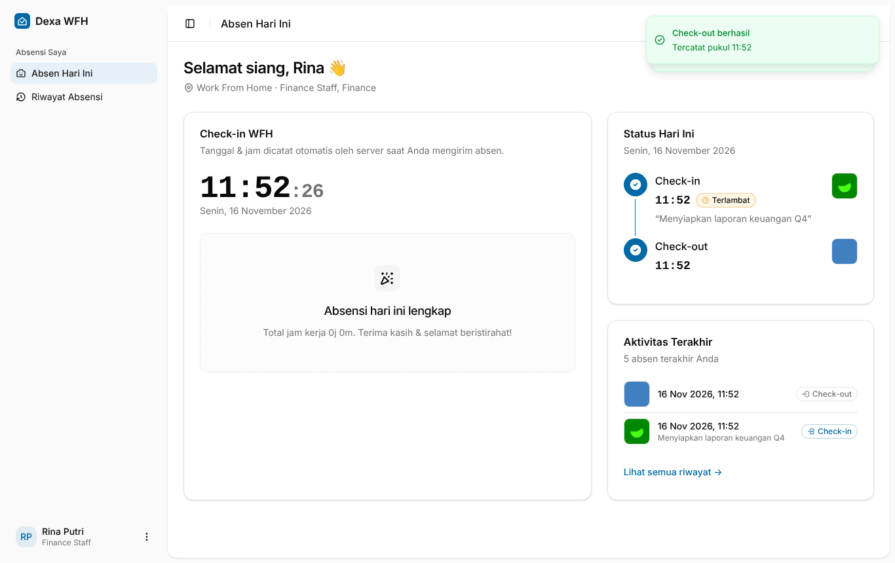
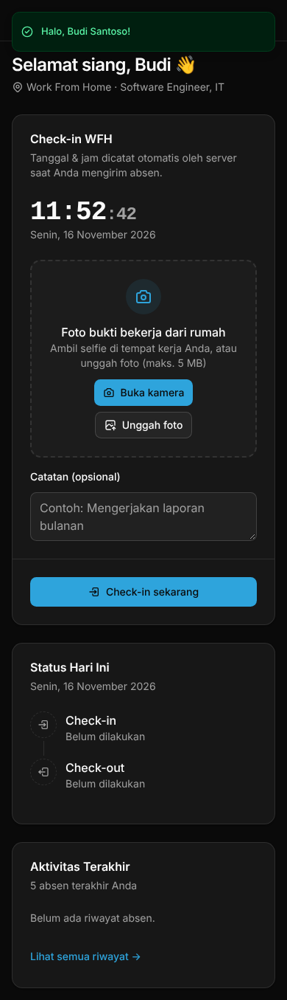
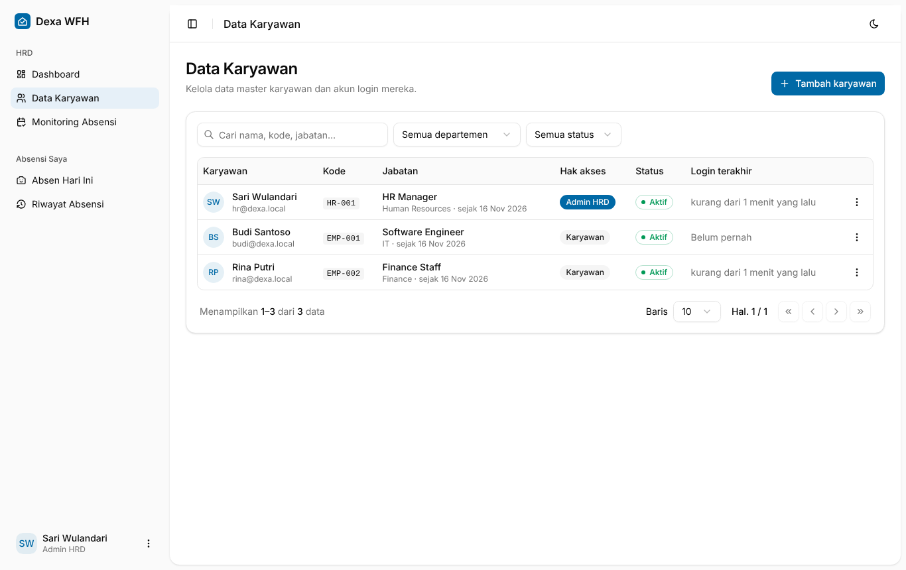
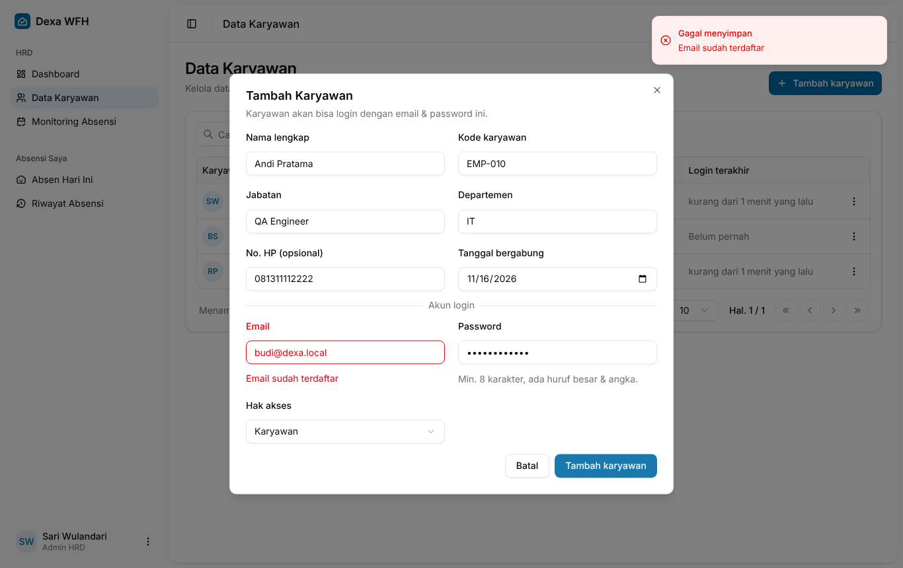
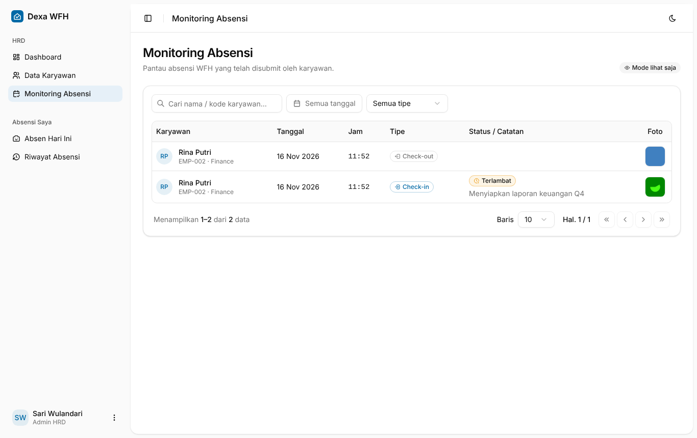
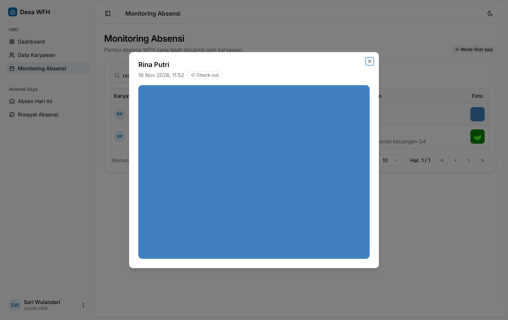

# Dexa WFH: Aplikasi Absensi & Monitoring Karyawan

Solusi **Fullstack Developer Skill Test – Dexa Group**. Satu aplikasi web dengan dua peran:

1. **Karyawan** bekerja dari rumah: check-in & check-out dengan **foto bukti** (kamera atau upload). Tanggal & jam dicatat oleh server, bukan perangkat. Karyawan juga bisa mengajukan **cuti/izin/sakit** dan **koreksi absen**.
2. **Admin HRD** mengelola **data master karyawan**, memantau absensi, membuat **rekap bulanan**, menyetujui pengajuan, dan mengatur **hari libur** (otomatis tersinkron dengan libur nasional & cuti bersama).



## Daftar isi

- [Fitur](#fitur)
- [Teknologi](#teknologi)
- [Mulai cepat](#mulai-cepat)
- [Konfigurasi](#konfigurasi-env)
- [Arsitektur](#arsitektur)
- [Aturan bisnis](#aturan-bisnis)
- [Struktur database](#struktur-database)
- [Struktur folder](#struktur-folder)
- [Endpoint API](#endpoint-api)
- [Keamanan](#keamanan)
- [Panduan pengembangan](#panduan-pengembangan)
- [Troubleshooting](#troubleshooting)
- [Screenshot](#screenshot)

---

## Fitur

### Karyawan

| Halaman | Isi |
| --- | --- |
| **Absen Hari Ini** | Jam live (mengikuti jam server), foto lewat **kamera** (getUserMedia) atau **upload** (JPG/PNG/WEBP, maks. 5 MB), catatan opsional. Langkah check-in → check-out, penanda **terlambat**, total jam kerja, rekap minggu berjalan. Memberi tahu bila hari ini libur atau karyawan sedang cuti. Bila absensi sudah ditutup, ada tautan langsung ke form koreksi. |
| **Riwayat Absensi** | Semua check-in/check-out dengan filter tanggal & tipe, pagination, pratinjau foto. Absen hasil koreksi diberi tanda **Dikoreksi**. |
| **Pengajuan** | **Cuti / Izin / Sakit** dan **Koreksi absen** (lupa check-in/check-out atau jam keliru). Status: Menunggu, Disetujui, Ditolak, Dibatalkan. Pengajuan yang masih menunggu bisa dibatalkan. |
| **Profil** | Data diri & ganti password. |

### Admin HRD

| Halaman | Isi |
| --- | --- |
| **Dashboard** | Hadir, tepat waktu, terlambat, belum check-in (karyawan yang cuti tidak dihitung). Grafik check-in 7 hari, kehadiran per departemen, aktivitas terbaru, daftar yang sedang cuti/izin/sakit. Di hari libur dashboard menampilkan nama liburnya. |
| **Data Karyawan** | Pencarian, filter departemen & status, pagination, **tambah/ubah** profil sekaligus akun login & hak akses, **nonaktifkan/aktifkan** (soft delete, riwayat tetap ada). |
| **Monitoring Absensi** | Seluruh absensi (view only): pencarian nama/kode/jabatan, filter tanggal & tipe, foto bukti, **export CSV** sesuai filter. |
| **Rekap Bulanan** | Per karyawan aktif: hari kerja, hadir, terlambat, tanpa check-out, cuti, izin, sakit, **alpa**, total jam kerja, persentase kehadiran. Navigasi bulan, filter departemen, **export CSV**. |
| **Persetujuan** | Setujui/tolak cuti/izin/sakit dan koreksi absen. Penolakan wajib beralasan. HRD tidak bisa memproses pengajuannya sendiri. Jumlah yang menunggu tampil di sidebar. |
| **Hari Libur** | Libur nasional & cuti bersama **disinkronkan otomatis** dari [APIHariLibur_V2](https://github.com/guangrei/APIHariLibur_V2). HRD bisa menambah libur perusahaan, menyembunyikan libur hasil sinkron, atau sinkron ulang kapan saja. |

### UI

Layout sidebar dari block shadcn `dashboard-01`, halaman login dari block `login-04`, mode terang/gelap, responsif (mobile), skeleton loading, empty state, toast, dan dialog konfirmasi. Warna hanya dari token CSS palet Dexa Group (primary `#A52823`) di `frontend/src/index.css`.

---

## Teknologi

| Layer | Teknologi |
| --- | --- |
| Backend | NestJS 11 (TypeScript, monorepo), **microservices via TCP** (`@nestjs/microservices`), TypeORM 0.3, MySQL, JWT, bcrypt, Zod 4, Multer |
| Frontend | React 19 + Vite, Tailwind CSS v4, **shadcn/ui**, React Router, TanStack Query 5, React Hook Form + Zod, Recharts, date-fns |
| Database | MySQL 8 (atau MariaDB 10.6+), Redis (penghitung login gagal & status sinkron libur) |
| Tooling | `tsc` (typecheck), oxlint, VS Code REST Client (`docs/api.http`) |

---

## Mulai cepat

### Prasyarat

- Node.js **20+** (dites dengan Node 22 dan 26)
- MySQL **8** berjalan di lokal
- **Redis** 6+ berjalan di lokal (`brew install redis && brew services start redis`, atau `docker run -d -p 6379:6379 redis`)
- Koneksi internet untuk sinkron hari libur (opsional; aplikasi tetap jalan tanpa internet)

### 1. Siapkan database

```sql
-- login sebagai root MySQL
CREATE DATABASE dexa_wfh CHARACTER SET utf8mb4 COLLATE utf8mb4_unicode_ci;
CREATE USER 'dexa'@'localhost' IDENTIFIED BY 'dexa';
GRANT ALL PRIVILEGES ON dexa_wfh.* TO 'dexa'@'localhost';
FLUSH PRIVILEGES;
```

> Bisa juga memakai user `root`: cukup sesuaikan `DB_USER` / `DB_PASSWORD` di `.env`.

### 2. Backend

```bash
cd backend
cp .env.example .env        # sesuaikan koneksi MySQL & JWT_SECRET (openssl rand -base64 48)
npm install
npm run db:setup            # buat tabel, jalankan migrasi kecil, isi akun demo (aman diulang)
npm run start:dev           # gateway + 4 microservice sekaligus (watch mode)
```

Cek `http://localhost:3000/api/health`. Semua service harus `"up"`:

```json
{ "gateway": "up", "auth": "up", "employee": "up", "attendance": "up", "leave": "up", "redis": "up" }
```

Mode produksi: `npm run build && npm run start:prod`.

### 3. Frontend

```bash
cd frontend
cp .env.example .env        # VITE_API_URL=http://localhost:3000
npm install
npm run dev                 # http://localhost:5173
```

### Akun demo

| Role | Email | Password |
| --- | --- | --- |
| Admin HRD | `hr@dexa.local` | `Admin123!` |
| Karyawan | `budi@dexa.local` | `Karyawan123!` |
| Karyawan | `rina@dexa.local` | `Karyawan123!` |

Di halaman login tersedia tombol **Akun demo** untuk mengisi kredensial otomatis. Akun HRD juga punya profil karyawan, jadi bisa absen dan mengajukan cuti.

---

## Konfigurasi (`.env`)

Backend membaca `backend/.env` (lihat `backend/.env.example`). Semua variabel punya nilai default kecuali `JWT_SECRET`.

| Variabel | Default | Keterangan |
| --- | --- | --- |
| `TZ` | `Asia/Jakarta` | Zona waktu pencatatan absen. Samakan dengan zona waktu server MySQL. |
| `WORK_START_TIME` | `09:00` | Check-in setelah jam ini dianggap **terlambat**. |
| `CHECK_OUT_MAX_TIME` | `22:00` | Lewat jam ini check-in & check-out ditolak, sehingga absen tidak menyeberang tengah malam. |
| `WORK_DAYS` | `1,2,3,4,5` | Hari kerja mingguan, ISO weekday (1 = Senin … 7 = Minggu). |
| `HOLIDAY_SYNC_URL` | feed `holidays.json` APIHariLibur_V2 | Sumber libur nasional & cuti bersama. Isi string kosong untuk mematikan sinkron. |
| `DB_HOST` / `DB_PORT` / `DB_USER` / `DB_PASSWORD` / `DB_NAME` | `localhost` / `3306` / `root` / kosong / `dexa_wfh` | Koneksi MySQL. |
| `REDIS_URL` | `redis://127.0.0.1:6379` | Redis untuk penghitung login gagal (gateway) serta status & kunci sinkron libur (attendance-service). |
| `JWT_SECRET` | **wajib** | Secret penandatangan token. |
| `JWT_EXPIRES_IN` | `8h` | Masa berlaku token. |
| `LOGIN_MAX_ATTEMPTS` | `5` | Login gagal per email sebelum dikunci (per IP: 4× lipatnya). |
| `LOGIN_LOCK_MINUTES` | `15` | Lama jendela penghitungan login gagal. |
| `GATEWAY_PORT` | `3000` | Port HTTP API gateway. |
| `AUTH_SERVICE_HOST` / `_PORT` | `127.0.0.1` / `4001` | Alamat TCP auth-service. |
| `EMPLOYEE_SERVICE_HOST` / `_PORT` | `127.0.0.1` / `4002` | Alamat TCP employee-service. |
| `ATTENDANCE_SERVICE_HOST` / `_PORT` | `127.0.0.1` / `4003` | Alamat TCP attendance-service. |
| `LEAVE_SERVICE_HOST` / `_PORT` | `127.0.0.1` / `4004` | Alamat TCP leave-service. |
| `UPLOAD_DIR` | `uploads` | Folder foto bukti (relatif terhadap `backend/`). |
| `MAX_UPLOAD_MB` | `5` | Ukuran maksimal foto. |
| `CORS_ORIGIN` | `http://localhost:5173` | Origin frontend, pisahkan dengan koma bila lebih dari satu. |

Frontend hanya butuh `VITE_API_URL` (default `http://localhost:3000`).

---

## Arsitektur

```
                    ┌──────────────────────────────┐
  React (Vite)      │      API Gateway :3000       │  HTTP/REST, JWT guard, role,
  :5173  ───HTTP──▶ │            /api/*            │  validasi Zod, upload foto, CSV
                    └──────┬─────────┬─────────┬───┘
                     TCP   │   TCP   │   TCP   │   TCP
              ┌────────────▼┐ ┌──────▼──────┐ ┌▼───────────────┐ ┌────────────────┐
              │ auth-service│ │ employee-   │ │ attendance-    │ │ leave-service  │
              │    :4001    │ │ service     │ │ service :4003  │ │ :4004          │
              │ users, JWT  │◀┤ :4002       │◀┤ attendances,   │▶│ leave_requests │
              │             │ │ employees   │ │ corrections,   │ │                │
              │             │ │             │◀┼─holidays       │ │                │
              └──────┬──────┘ └──────┬──────┘ └───────┬────────┘ └───────┬────────┘
                     └───────────────┴── MySQL (dexa_wfh) ───────────────┘
                                                      │
                                      HTTPS (sinkron libur, tiap 24 jam)
                                                      ▼
                                          APIHariLibur_V2 holidays.json
```

| Service | Port | Tabel milik | Memanggil | Tugas |
| --- | --- | --- | --- | --- |
| **api-gateway** | HTTP 3000 | – | semua service, Redis | Satu-satunya pintu HTTP: CORS, verifikasi token ke auth-service, cek role, validasi Zod, upload & pengiriman foto, limit login (Redis), format CSV. Tidak punya koneksi DB. |
| **auth-service** | TCP 4001 | `users` | – | Login, hash password (bcrypt), terbit & verifikasi JWT, buat/ubah/hapus akun. |
| **employee-service** | TCP 4002 | `employees` | auth | Master karyawan. Membuat karyawan = buat akun di auth-service dulu, lalu dihapus lagi (kompensasi) bila simpan profil gagal. |
| **attendance-service** | TCP 4003 | `attendances`, `attendance_corrections`, `holidays` | employee, leave, Redis | Check-in/out, riwayat, monitoring, dashboard, rekap bulanan, export, kalender kerja & sinkron libur, koreksi absen. |
| **leave-service** | TCP 4004 | `leave_requests` | employee | Pengajuan cuti/izin/sakit, pembatalan, persetujuan, dan daftar cuti disetujui untuk attendance-service. |
| **libs/common** | – | – | – | Kode bersama: message pattern (`PATTERNS`), schema Zod, `ZodValidationPipe`, `sendRpc`/`rpcError`, filter exception RPC, helper tanggal, `withEmployees`. |

Semua service memakai satu database MySQL supaya mudah dijalankan di lokal. Batas kepemilikan tabel dijaga di kode: tiap service hanya mendaftarkan entity miliknya, dan data service lain hanya dibaca lewat TCP.

### Alur request

1. Frontend mengirim `Authorization: Bearer <token>` ke gateway.
2. `AuthGuard` (global) memverifikasi token ke auth-service lewat TCP (`auth.verify`), lalu mengecek `@Roles(...)`. Endpoint publik ditandai `@Public()`.
3. Controller gateway memvalidasi body/query/param dengan Zod, lalu meneruskan ke service pemilik data dengan `sendRpc(client, PATTERNS.X.Y, payload)`.
4. Di service, error dilempar dengan `rpcError(status, message)`. Filter RPC mengubahnya menjadi `{ statusCode, message }`, dan gateway mengembalikannya sebagai HTTP status yang sama. Service yang mati atau timeout (8 detik) menjadi **503**.

---

## Aturan bisnis

### Absensi

- Maksimal **satu check-in dan satu check-out per hari** (unique key `employee_id, attendance_date, type`).
- Check-out hanya setelah check-in.
- **Terlambat** = check-in lewat `WORK_START_TIME`.
- Lewat `CHECK_OUT_MAX_TIME` check-in & check-out ditolak, sehingga satu hari absen tidak pernah menyeberang tengah malam.
- Jam dan tanggal selalu dari jam server. Frontend juga membaca "hari ini" dari respons API, bukan dari jam browser.
- Absen tetap bisa dilakukan di hari libur (lembur), tapi hari itu tidak pernah dihitung alpa.

### Cuti / izin / sakit

- **Cuti** harus diajukan sebelum atau pada tanggal mulai.
- **Izin & sakit** boleh menyusul paling lambat **7 hari** setelah tanggal mulai.
- Maksimal **31 hari** per pengajuan, dan tidak boleh bertabrakan dengan pengajuan lain yang masih menunggu atau sudah disetujui.
- Hanya pengajuan **Menunggu** yang bisa dibatalkan (oleh pemiliknya) atau diproses (oleh HRD).

### Koreksi absen

- Untuk tanggal **30 hari terakhir** sampai hari ini, dengan jam tidak melewati `CHECK_OUT_MAX_TIME` (dan tidak di masa depan).
- Check-in harus sebelum check-out. Koreksi check-out butuh check-in, baik yang sudah tercatat maupun koreksi check-in yang masih menunggu. Lupa keduanya: ajukan check-in dulu, lalu check-out.
- Saat disetujui, baris absen **dibuat atau diubah dalam satu transaksi**. `attendances.correction_id` menunjuk ke koreksinya, dan absen baru dari koreksi tidak punya foto.
- Tabel `attendance_corrections` sekaligus menjadi **jejak audit**: jam lama, jam baru, alasan, siapa yang memproses, dan kapan.

### Persetujuan (berlaku untuk cuti & koreksi)

- Penolakan wajib disertai alasan.
- HRD tidak bisa memproses pengajuannya sendiri.
- Perubahan status memakai `UPDATE ... WHERE status = 'PENDING'`, jadi dua HRD yang memproses bersamaan tidak saling menimpa (yang kalah mendapat 409).

### Hari kerja & hari libur

- Hari kerja = hari di `WORK_DAYS` yang **bukan** hari libur aktif.
- Libur nasional & cuti bersama disinkronkan dari `HOLIDAY_SYNC_URL` saat attendance-service start, tiap 24 jam, dan lewat tombol **Sinkronkan sekarang**:
  - Libur baru ditambahkan dengan sumber **Otomatis**.
  - Nama libur otomatis diperbarui bila berubah di sumber.
  - Libur otomatis yang hilang dari sumber (misalnya cuti bersama dibatalkan) dihapus, hanya untuk tahun yang ada di sumber.
  - Libur **Manual** dari HRD tidak pernah disentuh.
  - Kunci Redis `holidays:sync:lock` memastikan hanya satu instance attendance-service yang sinkron pada satu waktu, dan hasil terakhir disimpan di `holidays:sync:last`.
- Menghapus libur otomatis hanya **menyembunyikannya** (`is_active = 0`) agar tidak muncul lagi saat sinkron berikutnya. Libur yang disembunyikan bisa ditampilkan lagi.

### Rekap bulanan

Dihitung per karyawan aktif, mulai tanggal bergabung sampai hari ini (jam server):

| Kolom | Rumus |
| --- | --- |
| Hari kerja | Hari kerja yang sudah lewat. Hari ini baru dihitung bila karyawan sudah check-in atau sedang cuti. |
| Hadir | Hari kerja dengan check-in. |
| Terlambat | Check-in terlambat di hari kerja. |
| Tanpa check-out | Hari (sebelum hari ini) dengan check-in tanpa check-out. |
| Cuti / Izin / Sakit | Hari kerja tanpa check-in yang tercakup pengajuan **disetujui**. |
| **Alpa** | Hari kerja − hadir − cuti/izin/sakit. |
| Masuk di hari libur | Check-in di akhir pekan atau hari libur (tidak mengurangi alpa). |
| Jam kerja | Total selisih check-in → check-out. |

---

## Struktur database

DDL lengkap ada di [`backend/database/schema.sql`](backend/database/schema.sql) (InnoDB, utf8mb4, foreign key & index). `npm run db:setup` menjalankan file itu, lalu `migrate()` di [`database/setup.ts`](backend/database/setup.ts) untuk menambah kolom baru ke database lama.

```
users (auth)                    employees (employee)                attendances (attendance)
─────────────────────           ────────────────────────────        ─────────────────────────────────
id PK                           id PK                               id PK
email UNIQUE                    user_id FK → users UNIQUE           employee_id FK → employees
password_hash                   employee_code UNIQUE                type ENUM(CHECK_IN, CHECK_OUT)
role ENUM(HR_ADMIN, EMPLOYEE)   full_name, position, department     attendance_date DATE
is_active, last_login_at        phone, join_date, is_active         recorded_at DATETIME
created_at, updated_at          created_at, updated_at              photo_path NULL, notes
                                                                    correction_id NULL
                                                                    UNIQUE(employee_id, attendance_date, type)

attendance_corrections (attendance)      leave_requests (leave)             holidays (attendance)
───────────────────────────────────      ──────────────────────────         ──────────────────────────
id PK                                    id PK                              id PK
employee_id FK → employees               employee_id FK → employees         holiday_date DATE UNIQUE
attendance_date, type                    type ENUM(CUTI, IZIN, SAKIT)       name
requested_time TIME                      start_date, end_date               source ENUM(MANUAL, SYNC)
original_recorded_at NULL                reason                             is_active
reason                                   status ENUM(PENDING, APPROVED,     created_at
status ENUM(PENDING, APPROVED,                  REJECTED, CANCELLED)
       REJECTED, CANCELLED)              reviewed_by, reviewed_at,
reviewed_by, reviewed_at, review_note    review_note
created_at, updated_at                   created_at, updated_at
```

- Karyawan tidak pernah dihapus (soft delete lewat `is_active`), jadi riwayat absensi tetap utuh.
- TypeORM memakai `synchronize: false`: schema dikelola manual di `schema.sql` + entity. Kolom `DATE` dikembalikan sebagai string `YYYY-MM-DD`.

---

## Struktur folder

```
dexa-wfh/
├── backend/                         NestJS monorepo
│   ├── apps/
│   │   ├── api-gateway/src/         controller HTTP, AuthGuard, limit login, upload, CSV
│   │   │   ├── attendance/          absen, foto, monitoring, rekap, export
│   │   │   ├── auth/                login, guard, decorator, LoginLimiter
│   │   │   ├── employees/           master karyawan
│   │   │   ├── requests/            hari libur, cuti, koreksi
│   │   │   └── common/              csv.ts, employee.ts (helper gateway)
│   │   ├── auth-service/src/
│   │   ├── employee-service/src/
│   │   ├── attendance-service/src/  AttendanceService, CalendarService, CorrectionService
│   │   └── leave-service/src/
│   ├── libs/common/src/             PATTERNS, schema Zod, RPC helper, helper tanggal
│   ├── database/                    schema.sql, setup.ts (setup + migrasi + seed)
│   └── uploads/                     foto bukti (dibuat otomatis, jangan di-commit)
├── frontend/src/
│   ├── pages/                       satu file per halaman (lazy loaded)
│   ├── components/                  komponen aplikasi; ui/ = shadcn, blocks/ = block shadcn
│   ├── hooks/queries.ts             semua query & mutation TanStack Query
│   ├── lib/                         api.ts (axios), schemas.ts (Zod), format.ts
│   └── types.ts                     bentuk respons backend
└── docs/
    ├── api.http                     contoh request (VS Code REST Client)
    └── screenshots/
```

---

## Endpoint API

Semua endpoint berada di gateway dengan prefix `/api`. "login" = semua user yang sudah login.

### Auth & kesehatan

| Method | Endpoint | Akses | Keterangan |
| --- | --- | --- | --- |
| POST | `/auth/login` | publik | `{ email, password }` → `{ accessToken, user }`; 429 bila terlalu banyak gagal |
| GET | `/auth/me` | login | profil user + data karyawan |
| PATCH | `/auth/password` | login | `{ currentPassword, newPassword }` |
| GET | `/health` | publik | status koneksi TCP ke tiap microservice |

### Absensi

| Method | Endpoint | Akses | Keterangan |
| --- | --- | --- | --- |
| POST | `/attendance` | login | `multipart/form-data`: `type` (CHECK_IN/CHECK_OUT), `photo`, `notes?` |
| GET | `/attendance/today` | login | status hari ini, `closed`, `isWorkDay`, `holidayName`, `leave` |
| GET | `/attendance/me` | login | riwayat sendiri (`page, limit, from, to, type`) |
| GET | `/attendance/:id/photo` | login | file foto bukti (pemilik absen atau HRD) |
| GET | `/attendance` | HR_ADMIN | semua absensi (`page, limit, from, to, type, search, employeeId`) |
| GET | `/attendance/export` | HR_ADMIN | CSV dengan filter yang sama, maks. 10.000 baris |
| GET | `/attendance/summary` | HR_ADMIN | ringkasan dashboard + tren 7 hari |
| GET | `/attendance/recap` | HR_ADMIN | rekap bulanan (`month=YYYY-MM`, default bulan berjalan) |
| GET | `/attendance/recap/export` | HR_ADMIN | CSV rekap bulanan |

### Pengajuan

`/leave` (cuti/izin/sakit) dan `/corrections` (koreksi absen) punya bentuk yang sama.

| Method | Endpoint | Akses | Keterangan |
| --- | --- | --- | --- |
| POST | `/leave` | login | `{ type: CUTI/IZIN/SAKIT, startDate, endDate, reason }` |
| POST | `/corrections` | login | `{ date, type: CHECK_IN/CHECK_OUT, time: "HH:mm", reason }` |
| GET | `/leave/me`, `/corrections/me` | login | pengajuan sendiri (`page, limit, status`) |
| PATCH | `/leave/:id/cancel`, `/corrections/:id/cancel` | login | batalkan pengajuan sendiri yang masih PENDING |
| GET | `/leave`, `/corrections` | HR_ADMIN | semua pengajuan (`page, limit, status, search`) |
| PATCH | `/leave/:id/review`, `/corrections/:id/review` | HR_ADMIN | `{ status: APPROVED/REJECTED, note? }`, note wajib bila ditolak |

### Hari libur

| Method | Endpoint | Akses | Keterangan |
| --- | --- | --- | --- |
| GET | `/holidays` | login | libur per tahun (`year`), hari kerja mingguan, status sinkron terakhir |
| POST | `/holidays` | HR_ADMIN | tambah libur manual `{ date, name }` |
| PATCH | `/holidays/:id` | HR_ADMIN | `{ isActive: true }` menampilkan lagi libur yang disembunyikan |
| DELETE | `/holidays/:id` | HR_ADMIN | libur manual dihapus, libur otomatis disembunyikan |
| POST | `/holidays/sync` | HR_ADMIN | sinkron ulang dari `HOLIDAY_SYNC_URL` |

### Karyawan

| Method | Endpoint | Akses | Keterangan |
| --- | --- | --- | --- |
| GET | `/employees` | HR_ADMIN | list (`page, limit, search, department, status`) |
| GET | `/employees/stats` | HR_ADMIN | statistik & daftar departemen |
| GET | `/employees/:id` | HR_ADMIN | detail |
| POST | `/employees` | HR_ADMIN | tambah karyawan + akun login |
| PATCH | `/employees/:id` | HR_ADMIN | ubah data / password / role / status (tidak bisa menonaktifkan atau menurunkan diri sendiri) |
| DELETE | `/employees/:id` | HR_ADMIN | nonaktifkan (soft delete) |

### Format respons

List memakai bentuk paginasi yang sama:

```json
{ "data": [ ... ], "meta": { "page": 1, "limit": 10, "total": 42, "totalPages": 5 } }
```

Error selalu `{ statusCode, message }`. Error validasi menambahkan pesan per field, yang dibaca frontend untuk menandai input:

```json
{ "statusCode": 400, "message": "Validasi gagal", "errors": { "email": "Format email tidak valid" } }
```

| Status | Arti |
| --- | --- |
| 400 | validasi gagal atau melanggar aturan bisnis |
| 401 | belum login / token tidak valid / akun nonaktif |
| 403 | role tidak sesuai, atau memproses pengajuan sendiri |
| 404 | data tidak ada (juga untuk foto milik karyawan lain) |
| 409 | duplikat, pengajuan sudah diproses, atau sinkron hari libur sedang berjalan |
| 413 | foto melebihi `MAX_UPLOAD_MB` |
| 429 | terlalu banyak login gagal |
| 502 | sinkron hari libur gagal mengambil sumber |
| 503 | microservice tidak bisa dihubungi |

Contoh request siap pakai ada di [`docs/api.http`](docs/api.http) (VS Code REST Client).

---

## Keamanan

- **Password** di-hash dengan bcrypt (cost 10). Aturan: minimal 8 karakter, ada huruf besar & angka.
- **Token JWT** diverifikasi ke auth-service di setiap request, jadi akun yang dinonaktifkan langsung tidak bisa dipakai walau tokennya belum kedaluwarsa.
- **Limit login gagal**: `LOGIN_MAX_ATTEMPTS` per email dan 4× lipatnya per IP dalam `LOGIN_LOCK_MINUTES`, lalu dibalas 429. Login berhasil mereset hitungan email tersebut. Hitungan disimpan di **Redis** (key `login:fail:email:*` dan `login:fail:ip:*` dengan TTL), jadi berlaku sama untuk semua instance gateway dan tidak hilang saat gateway restart. Bila Redis mati, login tetap bisa dipakai tanpa pembatasan (fail-open) dan peringatan dicatat di log.
- **Foto bukti tidak publik.** Tidak ada route statis `/uploads`. Foto hanya bisa diambil lewat `GET /api/attendance/:id/photo` dengan token; selain pemilik & HRD mendapat 404. Path file di disk tidak pernah dikirim ke client.
- **Upload divalidasi** dari isi file (magic bytes JPG/PNG/WEBP), bukan hanya mimetype dari browser. Nama file diganti UUID, dan foto dihapus lagi bila request gagal.
- **Export CSV** memakai BOM UTF-8 dan meng-escape sel yang diawali `=`, `+`, `-`, `@` untuk mencegah CSV/formula injection di Excel.
- **Otorisasi berlapis**: role dicek di gateway, sementara kepemilikan data (batalkan pengajuan, foto) dicek di service.

---

## Panduan pengembangan

### Perintah

| Lokasi | Perintah | Fungsi |
| --- | --- | --- |
| `backend/` | `npm run start:dev` | semua app dalam watch mode |
| `backend/` | `npx nest start <app> --watch` | satu app saja, mis. `leave-service` |
| `backend/` | `npm run typecheck` | `tsc --noEmit` untuk apps, libs, database |
| `backend/` | `npm run build` / `start:prod` | build webpack ke `dist/apps/<app>/main.js` |
| `backend/` | `npm run db:setup` | schema + migrasi + seed (idempotent) |
| `frontend/` | `npm run dev` / `build` | Vite dev server / build produksi (`tsc -b && vite build`) |
| `frontend/` | `npm run lint` | oxlint |
| `frontend/` | `npx shadcn@latest add <komponen>` | tambah komponen shadcn (`components.json` sudah ada) |

Belum ada test suite otomatis. Gunakan `docs/api.http` untuk uji manual endpoint.

### Menambah endpoint

1. Tambahkan pattern di `PATTERNS` (`backend/libs/common/src/constants.ts`).
2. Tambahkan schema Zod + tipe di `backend/libs/common/src/schemas/`.
3. Tambahkan handler `@MessagePattern` di controller service pemilik data. Lempar error dengan `rpcError(status, pesan)`.
4. Tambahkan method di controller gateway dengan `new ZodValidationPipe(schema)` dan `sendRpc`. Pasang `@Roles(Role.HR_ADMIN)` bila khusus HRD.
5. Di frontend, tambahkan schema di `src/lib/schemas.ts`, tipe di `src/types.ts`, dan hook di `src/hooks/queries.ts`. Validasi sengaja diduplikasi, jadi ubah kedua sisi bersamaan.

### Mengubah schema database

Ubah `database/schema.sql` **dan** entity-nya. Untuk database yang sudah ada, tambahkan ALTER idempotent di `migrate()` pada `database/setup.ts` (MySQL 8 tidak punya `ADD COLUMN IF NOT EXISTS`, jadi cek `information_schema` dulu), lalu jalankan `npm run db:setup`.

### Menambah microservice

Ikuti pola `leave-service`: folder `apps/<nama>/` dengan `tsconfig.app.json` dan `main.ts` yang memanggil `bootstrapTcpService`, daftarkan di `nest-cli.json`, tambahkan host/port di `libs/common/src/clients.ts`, lalu masukkan ke script `build`, `start:dev`, dan `start:prod` di `package.json`. Tambahkan juga ke `health.controller.ts`.

### Konvensi

- Teks UI, pesan error, dan komentar kode dalam **Bahasa Indonesia**.
- Warna hanya lewat token CSS (`bg-primary`, `text-warning`), bukan warna Tailwind mentah.
- Form memakai React Hook Form + Zod lewat komponen `FormField`.

---

## Troubleshooting

| Gejala | Penyebab & solusi |
| --- | --- |
| `503 Service Unavailable` di `/api/leave` atau dashboard/rekap | leave-service tidak jalan. Setelah update kode, **restart** `npm run start:dev` (watch mode tidak menjalankan app baru). Cek `/api/health`. |
| `Unknown column ...` di log service | Database belum dimigrasi. Jalankan `npm run db:setup`. |
| `EADDRINUSE` saat start | Port 3000/4001–4004 masih dipakai proses lain, mis. service yang dijalankan terpisah. Matikan dulu proses tersebut. |
| Jam absen bergeser 7 jam | Zona waktu MySQL berbeda dari `TZ`. Samakan keduanya. |
| Halaman Hari Libur: "Sinkron terakhir gagal" | Tidak ada internet atau sumber berubah format. Aplikasi tetap jalan; tambahkan libur manual atau coba **Sinkronkan sekarang** lagi. |
| CSV terbuka jadi satu kolom di Excel | Excel dengan format regional Indonesia memakai pemisah `;`. Buka lewat **Data → From Text/CSV**, atau ganti pemisah di `backend/apps/api-gateway/src/common/csv.ts`. |
| Login dibalas 429 | Terlalu banyak login gagal. Tunggu sesuai pesan, atau hapus hitungannya: `redis-cli del login:fail:email:<email>` (dan `login:fail:ip:<ip>` bila IP yang terkunci). |
| `/api/health` menunjukkan `"redis": "down"` | Redis belum jalan: `brew services start redis`. Selama Redis mati, limit login tidak aktif dan status sinkron libur hanya tersimpan per instance. |
| Foto tidak tampil | Pastikan file masih ada di `backend/uploads/` dan user adalah pemilik absen atau HRD. |

---

## Screenshot

| | |
| --- | --- |
|  |  |
|  |  |
|  |  |
|  |  |

> Screenshot halaman Pengajuan, Persetujuan, Rekap Bulanan, dan Hari Libur belum tersedia.

---

## Kredit

Data libur nasional & cuti bersama: [guangrei/APIHariLibur_V2](https://github.com/guangrei/APIHariLibur_V2) (GPL-3.0), diambil saat runtime. Komponen UI dari [shadcn/ui](https://ui.shadcn.com) (style `new-york-v4`).
